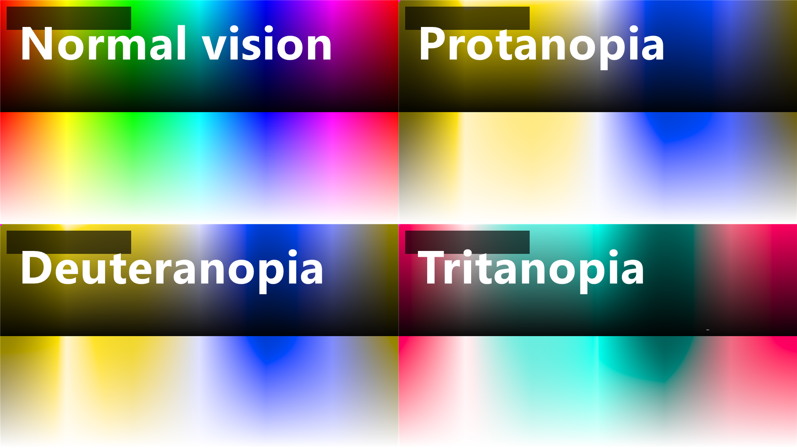

# DaltonicPOV

See your screen the way a colour-blind person sees it. A live filter over the whole Windows desktop,
on every monitor, that shows exactly what a dichromat sees: no extra distortion, no over-bright
colours, no colours the eye cannot make.



## Modes

- Protan — no red cones
- Deutan — no green cones
- Tritan — no blue cones

The model comes from D. B. Judd's colour vision work at the US National Bureau of Standards (1944–1950,
public domain). It runs on your monitor's own colours, read from its EDID.

## Use

Start `DaltonicPOV.exe`. A tray icon appears; pick a mode in its menu, or «Normal vision» to turn the
filter off. Clicks go through the filter, and it never takes the focus.

## Build

Needs Visual Studio (or its Build Tools) with the C++ workload.

```
pwsh -File build.ps1
```

The exe and `plugins\` land in `bin\`. Each mode lives in a plugin DLL; the host has no mode logic.

## Limits

- Tested on Windows 10 with SDR monitors and UAC turned off.
- The mouse cursor is not filtered yet.
- Weak forms (anomalous trichromacy) and full colour blindness are not there yet: no open model
  works without the monitor's spectra.

## License

Apache License 2.0, see [LICENSE](LICENSE) and [NOTICE](NOTICE). Copyright 2026 Denis Dementjev
([ORCID 0009-0006-7332-5115](https://orcid.org/0009-0006-7332-5115)).
